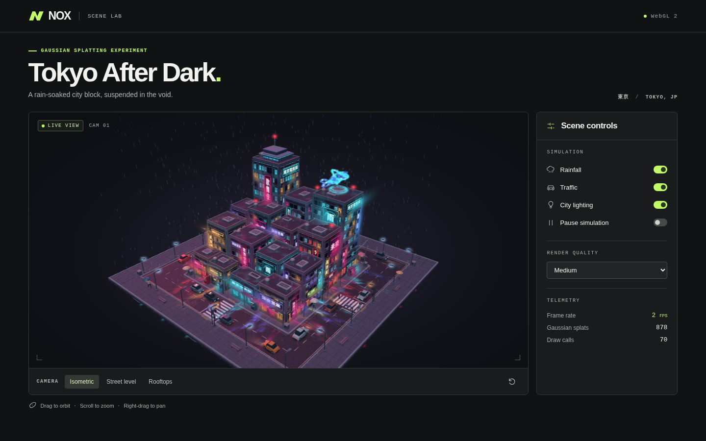

# NOX Tokyo · Tokyo After Dark

Интерактивная миниатюра ночного Токио на парящей платформе. Пятнадцать зданий образуют плотный торговый квартал с переулками. Две полосы кольцевой дороги огибают магазины, а четыре перехода связывают внутренний и внешний тротуары. Геометрия, движение, освещение и дождь вычисляются в браузере.



## Просмотр

Файл **NOX-Tokyo.html** из комплекта поставки открывается напрямую в современном Chromium с WebGL 2. Он содержит код, стили и графику вывесок. Для разработки нужны Node.js 24 и npm.

```sh
npm ci
npm run dev
```

`npm run build` собирает статический сайт в `dist/`. Команда `npm run preview` запускает эту сборку на локальном HTTP-сервере. Команда `npm run standalone` дополнительно формирует `dist/NOX-Tokyo.html`.

## Управление

| Действие | Управление |
| --- | --- |
| Орбита | Перетаскивание мышью, одним пальцем или стрелки при фокусе на сцене |
| Приближение | Колесо, жест двумя пальцами или клавиши + и − |
| Сдвиг | Правая кнопка мыши, жест двумя пальцами или Shift со стрелками |
| Камера | Три ракурса под сценой. Кнопка сброса и клавиша Home возвращают исходный вид |
| Симуляция | Rainfall переключает дождь, Traffic останавливает машины, City lighting меняет интенсивность света, Pause simulation замораживает время |
| Детализация | Low, Medium и High задают выборку сплатов, плотность дождя и предел разрешения буфера |

На телефоне кнопка в заголовке Scene controls раскрывает панель. При системной настройке уменьшенного движения симуляция стартует на паузе. Телеметрия показывает измеренную частоту кадров, число отправляемых на отрисовку сплатов и число вызовов рисования за кадр.

## Устройство сцены

- **Сплаты.** Каждый имеет пространственный центр, три осевых стандартных отклонения, цвет и прозрачность. Шейдер проецирует трёхмерную ковариацию через якобиан перспективы, рассчитывает эллипс в пикселях и интегрирует его в изображение с гауссовым спадом прозрачности. Камера меняет видимую форму эллипса. Экземпляры сортируются по глубине центра и проверяются по буферу глубины непрозрачной геометрии. Техническое описание и допущения приведены в [rendering.md](docs/rendering.md).
- **Город.** Программные фасады, карнизы, отдельные окна, оборудование крыш и городской транспорт задают силуэт и перекрытия. Атлас японских надписей закреплён на поверхностях в пространстве. Облако сплатов изображает светящегося карпа кои над крышей. Сплаты также образуют свет на фасадах и цветные следы на асфальте. Мокрая дорога использует процедурные блики. Полноценное трассирование отражений и реконструкция по фотографиям в эту модель не входят.
- **Движение.** Маршруты соединяют прямые участки и дуги с непрерывной касательной. Четырнадцать машин выдерживают интервал на двух встречных полосах. Шестнадцать пешеходов идут по тротуарам, ожидают сигнал и проверяют, свободен ли переход. Пауза транспорта сохраняет машины на дороге.
- **Рендеринг.** TypeScript, Vite, Three.js и GLSL для WebGL 2. Повторяющиеся части используют инстансинг. Атмосферные эффекты зависят от общего времени симуляции. Данные статических сплатов хранятся на GPU. При повороте камеры обновляется порядок индексов.
- **Качество.** Low выбирает около 34% сплатов, до 320 капель и до 0,75 пикселя буфера на CSS-пиксель. Medium — около 64%, 680 капель и до 1,25. High — все сплаты, 1100 капель и до 2. Детерминированная выборка сохраняется при движении камеры.

## Проверки

```sh
npm run typecheck
npm run lint
npm test
npm run build
npx playwright install --with-deps chromium
npm run test:browser
npm run standalone
npm run test:offline
```

В облачном прогоне прошли 9 unit-тестов, 13 браузерных сценариев Chromium и отдельная проверка автономного HTML через file://. Оба набора тестов вернули ноль ошибок. Проверки типов, линтер и production build также завершились успешно.

Для Medium на Chromium 156 с программным SwiftShader измерены **2,25 FPS**, медиана интервала между кадрами **433,4 мс**, p95 **516,6 мс**. Выборка — 24 интервала, окно 1440 × 900, буфер 1019 × 522, 878 активных сплатов из 1330. Производительность на Radeon RX 580 2048SP остаётся непроверенной. На кольцевом маршруте машины поворачивают по дугам и уступают у переходов. Выбор ответвлений на многополосном перекрёстке не моделируется.

Снимки собраны в [screenshots](screenshots/). Методика браузерных тестов, данные движения и замеры времени кадра доступны в [отчёте QA](docs/qa.md). Контрольная сцена для проверки формы, сортировки и перекрытий описана в [проверке сплатов](docs/splat-verification.md). Версии инструментов, их требования и лицензии перечислены в [compatibility.md](docs/compatibility.md).

## GitHub и публикация

[Открыть NOX Tokyo в браузере](https://zxcarbuz.github.io/nox-tokyo-splats/)

Workflow **Verify** проверяет push и pull request. Для обновления сайта запустите **Publish to Pages** для ветки `main` во вкладке Actions. Workflow проверяет типы, линтер и unit-тесты, собирает Vite с базой `/nox-tokyo-splats/` и публикует каталог `dist/` через GitHub Actions. Для просмотра без сети доступна [автономная сборка v1.0.0](https://github.com/zxcarbuz/nox-tokyo-splats/releases/tag/v1.0.0).

Код проекта поставляется без автоматически выбранной лицензии. Уведомление MIT о Three.js включено в статическую сборку и в автономный HTML.
